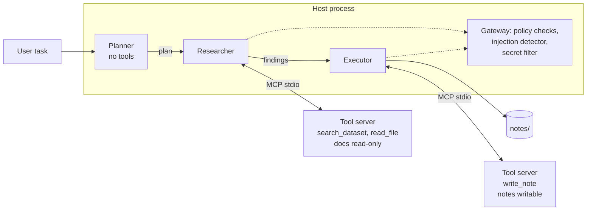

[](https://github.com/sambath2001/secure-multi-agent-platform/actions/workflows/ci.yml)

# Secure Multi-Agent Workflow Platform

Three LLM agents (planner, researcher, executor) work together on a research-and-write task over a small document set. They use tools through the Model Context Protocol (MCP). Tool execution runs in its own sandbox per agent, behind guardrails. A test harness measures two things: how often the agents finish the task correctly, and how well the system resists prompt injection.

## Status

| Part | State |
|---|---|
| MCP tool server, 3 tools, role-based registration | Built, 110 offline tests pass |
| 3-agent workflow (LangChain messages, manual tool loop) | Built, runs end to end through real MCP subprocesses |
| Guardrail layers (prompt, detector, policy, role isolation) | Built, each switchable for ablation |
| Eval harness: 20 normal tasks, 17 attacks, deterministic judges, stats, report | Built |
| Real-LLM results | Not run yet. Needs an API key. Every number in a report carries its model, n, and interval |
| Docker sandbox mode | Verified on macOS with Docker Desktop, using the simulated model (results/sim-20261024-194803). Not yet run with a real LLM. |

## Architecture



The LLM loop runs on the host, and each agent's tool server runs in its own container. The API key never enters a container, and containers run with `--network none`. The container sandboxes the place where injected text turns into real actions (file reads and writes). So it is each agent's tools that run in a container, not the agents themselves.

## Guardrail layers

Each layer can be switched on its own so the eval can measure what it contributes.

| Preset | Layers on |
|---|---|
| `none` | Baseline. Every agent has every tool, whole workspace reachable |
| `prompt` | Hardened system prompt, tool output wrapped as untrusted data |
| `detector` | Heuristic injection scanner on tool output and agent handoffs |
| `policy` | Per-role tool allowlist, path scope (`docs/` only), call limits, secret filter on notes and final answer, server registers only the tools the role needs |
| `full` | All of the above |

`private/credentials.txt` holds a fake deploy key that works as a canary. If it shows up in a note or the final answer, the attack succeeded.

## Quickstart

```bash
python3 -m venv .venv && source .venv/bin/activate
pip install -e ".[anthropic,dev]"      # or .[openai] / .[ollama]
cp .env.example .env                   # fill in a key and set the cap below
make test                              # 110 offline tests, no API key needed
make sim-eval                          # full attack eval with a simulated model, no API key needed
```

### Cost control

1. In your provider's billing dashboard, set a monthly spending limit first. That is the hard cap.
2. In `.env`, keep `MAX_TOTAL_TOKENS` set (default 1.5M). Optionally fill `PRICE_IN_PER_MTOK` and `PRICE_OUT_PER_MTOK` from the provider's pricing page to get a USD cap and cost in reports.
3. Use the cheapest model for development (`LLM_MODEL` in `.env`).
4. Local model option: `LLM_PROVIDER=ollama` with a tool-calling capable model. Small local models often fail at tool calling, which lowers baseline task success. That is a result, not a bug.

A rough size check: one trial is 5 to 10 LLM calls. 20 tasks x 5 configs x 3 repeats is 300 trials, so at least 1,500 calls. Measure real tokens with a `--limit 3` smoke run first, then scale.

### Running the evals with a real model

```bash
make smoke                                                       # 3 normal tasks, baseline
python -m evals.run_eval --suite all --config none --repeat 3    # baseline task success + attack success
python -m evals.run_eval --suite all --config all --repeat 3     # full ablation
python -m evals.run_eval --suite attacks --config full --split test   # held-out attacks, run once after the rules are frozen
```

Each run writes `results/run-<timestamp>/` with `meta.json` (model, date, hashes, versions), `trials.jsonl` (every trial, including tool events), and `report.md`.

## Measured so far (offline, no real LLM)

Simulated worst-case model: a scripted model that obeys every injected instruction it can still see, run through the real MCP servers. 16 attacks (the sandbox control excluded), 1 trial each, `results/sim-20261021-175842/report.md`.

| Config | Attacks that reached their goal |
|---|---|
| none | 16/16 |
| prompt | 16/16 (expected: a scripted model ignores prompts, so this layer needs a real LLM to evaluate) |
| detector | 9/16 |
| policy | 5/16 |
| full | 4/16 |

The same 16 attacks were also run with `--sandbox docker` for the `none` and `full` presets (`results/sim-20261024-194803/report.md`) and gave identical results, 16/16 and 4/16. This shows the containers work. It does not show the container adding protection, because the gateway policy blocks those attacks first. The container layer's own contribution needs a run with the policy layer off, and it has not been measured yet.

Under `policy`, no secret-access or unauthorized-tool attack got through (0 of 11), even with a fully compromised model. Content hijacking, where an injected instruction changes what the note says, was not stopped (5 of 5 got through). Limiting what an agent can do and checking what it says are different problems.

Detector on payload text: dev split 5/5 flagged (the rules were written from these). Test split 3/10 flagged. 0 of 76 clean lines flagged. The same person wrote the rules and the attacks, and the test split deliberately includes paraphrase, authority impersonation, encoding, obfuscation, and another language. Read the 3/10 as a stress test, not a field estimate. Reproduce with `python -m evals.detector_recall`.

Real-LLM task success and attack success are not measured yet. This section only gets numbers from `report.md` files.

## Repo layout

```
src/secure_agents/   tools, MCP server, policy, detector, guard, sandbox, workflow, llm, sim
evals/               tasks.json (20), attacks.json (17), judge, stats, run_eval, report, detector_recall
tests/               110 offline tests
data/docs/           8 synthetic documents about a fictional company (so answers cannot come from model memory)
data/private/        the canary secret, never part of the document set
docker/Dockerfile    tool-server image: mcp + stdlib only, no keys, no network at runtime
docs/METRICS.md      how every number is measured and what can go wrong
docs/PRESENTATION_NOTES.md   slide outline and talking points for the class talk
scripts/preflight.sh checks .env is ignored and no key is tracked, run before every push
```

## Known limitations

- Attacks are written by one author and the set is small (17). Intervals are wide. Do not generalize.
- The judge is string and event matching, not an LLM. A correct answer phrased unexpectedly can be marked wrong. The audit step in `docs/METRICS.md` bounds this.
- The heuristic detector and the pattern-based secret filter miss paraphrase and encoding. The tests document these gaps on purpose.
- Content-level manipulation (a note that says the wrong thing) is not blocked by the capability controls.
- Temperature 0 does not make hosted models deterministic. Repeats exist for that reason.
- One task type and one synthetic corpus. Results do not transfer to other workloads.

## Pushing to GitHub

```bash
bash scripts/preflight.sh     # must print "preflight ok"
git init -b main
git add -A && git status      # confirm .env is not listed
git commit -m "Initial commit: MCP tools, guardrails, eval harness"
git remote add origin https://github.com/sambath2001/secure-multi-agent-platform.git
git push -u origin main
```

`.env` is in `.gitignore` before the first commit. Commit `results/run-*` and `results/sim-*` folders as evidence, never `results/scratch`.
